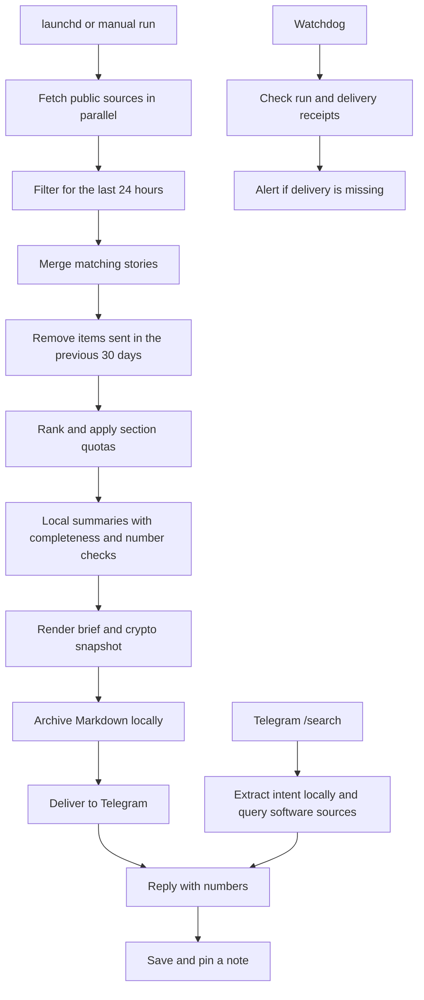

<div align="center">

# Good Morning Bobby

**Wake up to the tech stories worth your attention.**


</div>

## Description

Good Morning Bobby is a self-hosted morning tech brief that turns public feeds, release
notes, and developer news into a concise Telegram digest. It gathers the last 24 hours
of updates, filters repeat stories, and uses a local Ollama model to summarize longer
source text. Every item links back to its source.

**One morning message. A local archive. A bot that helps you keep what matters.**

| In your brief | What you get |
| --- | --- |
| AI & LLM | Updates from OpenAI, Anthropic, Google DeepMind, Google AI, and Hugging Face |
| GitHub trending | Repositories with stars, daily growth, and language details |
| Releases | Stable releases from selected developer tools and frameworks |
| Tech news | Hacker News and technology press, filtered for freshness |
| Crypto | A market snapshot from CoinGecko, with optional CoinMarketCap support |

Reply with item numbers to save a pinned note. Use `/search` to find software, libraries,
and repositories, then save the results in the same way. `/notes` brings recent saves
back into view.

Inference runs on your Mac. The default setup requires no paid LLM API, although it
still needs internet access to fetch sources and communicate with Telegram. Individual
source failures appear in the brief; if no source returns items, the run fails visibly.

## Requirement

| Requirement | Purpose |
| --- | --- |
| macOS | Keychain secrets, launchd scheduling, and local notifications |
| Python 3.14 or newer | Runtime for both workspace packages |
| `uv`, `just`, and Git | Dependency installation and project commands |
| Ollama | Local structured output and summaries |
| `qwen2.5:7b-instruct-q4_K_M` | Default model for summaries and search intent |
| Telegram bot and a personal chat | Daily delivery, software search, and saved notes |
| Internet access | Public feeds, GitHub, package registries, and Telegram |

A Mac with 16 GB of memory is a practical starting point for the default 7B model.
The context window defaults to 8,192 tokens, and summaries are processed in small
batches. Historical machine measurements are in [docs/measured-facts.md](docs/measured-facts.md).

## Installation

### 1. Install the tools and clone the project

With Homebrew available:

```bash
brew install uv just ollama

git clone https://github.com/BobbyAMK/good-morning-bobby.git
cd good-morning-bobby

uv python install 3.14
just sync
cp .env.example .env
```

### 2. Start Ollama and download the model

```bash
brew services start ollama
just pull-models
```

The default configuration in `.env.example` uses the same pinned 7B model for both
model tiers. Set `PA_TZ` in `.env` to your timezone. Keep credentials out of that file;
the Telegram token is stored in macOS Keychain.

### 3. Connect Telegram

Create a bot with **@BotFather** using `/newbot`, then run:

```bash
just telegram-token
```

Open your new bot in Telegram, press **Start**, and send a message. Then bind the chat:

```bash
just telegram-bind
```

The bound chat is the only chat accepted by the inbound bot. Bind it before starting
`pa-bot`; both binding and the bot read Telegram updates.

### 4. Verify the setup

```bash
just doctor
uv run pa-core-admin smoke-llm
just brief-dry
```

The preview fetches real sources and runs local inference. It records local run logs
and telemetry, but does not deliver the brief or mark its items as sent.

## Usage

### Generate and inspect a brief

```bash
just brief-dry    # Preview in the terminal
just brief        # Generate and deliver; deliberately allows a same-day rerun
just show         # Read the latest archived brief
just runs         # Inspect recent run outcomes
just cost         # Inspect model calls, tokens, and latency
```

For the scheduled job's once-per-day behavior, run without `--force`:

```bash
uv run pa-morning-brief run
```

Items matching stories sent during the previous 30 days are filtered out. A forced
same-day rerun can include that day's items again.

### Use the Telegram bot

| Message | Action |
| --- | --- |
| `/search react animation` | Find libraries, repositories, and tools |
| `/search thư viện HTTP client cho Python` | Search using a Vietnamese request |
| Reply `3 7` to a brief or search result | Save items 3 and 7 as one pinned note |
| Reply `2-4` | Save a range of items |
| `/notes` | List recent saved notes |
| `/help` | Show bot instructions |

Search uses GitHub repositories, npm or PyPI enrichment where applicable, and relevant
Hacker News discussions. The local model extracts intent; code ranks the results.
Saving an item twice points back to its existing note.

### Schedule your mornings

```bash
just install-brief
```

This deploys a separate runtime and installs three launchd jobs:

| Job | Schedule |
| --- | --- |
| Morning brief | 06:05, with catch-up attempts at 09:00 and 12:30 |
| Watchdog | 09:30 and 13:00 |
| Telegram bot | Runs continuously with `KeepAlive` |

Times follow the Mac's system clock. Keep `PA_TZ` aligned with the system timezone so
logical dates and watchdog deadlines agree with the schedule.

A database constraint prevents catch-up attempts from sending a second successful
brief for the same date. The watchdog checks delivery to the primary sink and alerts
when the expected brief is missing.

To configure a daily wake attempt at 05:58, use `just wake`. Scheduling still depends
on the Mac being available; closed-lid behavior and power state can affect execution.

```bash
just status morning-brief
just status bot
just bot-logs
just kick morning-brief
```

Run `just install-brief` again after code or configuration changes. For foreground bot
development, `just bot-dev` stops the installed bot first to avoid competing update
pollers. Restore scheduled operation with `just install-brief`.

### Develop and verify

```bash
just test
just lint
uv run python evals/run_search.py
```

Unit tests run offline. The search evaluation is a separate, manual check that needs
Ollama and live public services; see [evals/README.md](evals/README.md).

## Workflow



Freshness, duplicate detection, ranking, and number-to-item lookup run in code.
Timestamped items use a 24-hour window. Sources publishing only a date are compared
by calendar day, so an item near the boundary can be almost 48 hours old.
Display text uses plain hyphens; source URLs retain their original characters.
Short source descriptions are used directly. Longer text is summarized in batches;
missing summaries are retried individually, and summaries containing unsupported
numbers fall back to the source's first sentence. These checks reduce specific errors;
they do not establish that every paraphrase is correct.

The run harness adds a process lock, a wall-clock timeout, local telemetry, and delivery
receipts. A Markdown archive is written before network delivery, so a Telegram failure
still leaves the generated brief available on disk.

| Path | Responsibility |
| --- | --- |
| `packages/morning-brief` | Sources, filtering, summaries, rendering, bot, search, and notes |
| `packages/core` | Configuration, Keychain access, Ollama, SQLite, delivery, and watchdog |
| `ops/` | Runtime wrapper and launchd templates |
| `tests/` | Offline behavior checks and parser fixtures |
| `evals/` | Manual live software-search evaluation |

Local state uses `~/Library/Application Support/pet-agents`, logs use
`~/Library/Logs/pet-agents`, and Keychain uses the service name `pet-agents`. These
storage identifiers are retained for compatibility with existing installations.
The deployed runtime lives outside the repository so launchd does not depend on
editable source paths under `Documents`.
